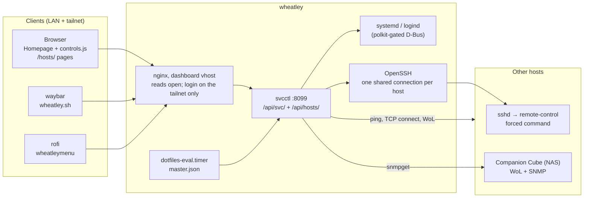
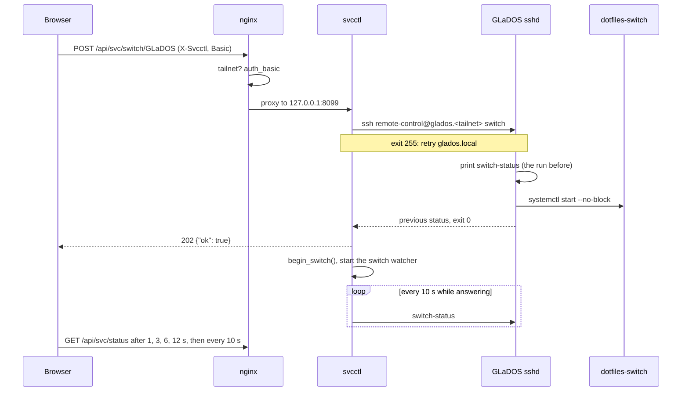

# svcctl: Wheatley's server controller

svcctl is the daemon behind the homelab dashboard's controls. It runs on
wheatley, the always-on server, and does three jobs:

- **Commands.** Start, stop and restart services. Wake, power off, reboot and
  switch hosts. Turn Tailscale on and off on other hosts.
- **Live status.** Whether each machine is up, the state of each unit and
  switch, Tailscale, open ports, latency, and per-service resource usage.
- **Host pages.** A read-only API over each host's NixOS generations, closure
  diffs and deploy state against master.

It is one Python process using only the standard library
(`svcctl.py` plus its `host_pages.py` module). It listens on
`127.0.0.1:8099` behind the dashboard's nginx and runs unprivileged. Every
remote operation, read or write, leaves wheatley as an SSH login to a
dedicated user on the target host. That user's only key is pinned to a forced
command that accepts a fixed set of verbs.

## Contents

1. [Components](#components)
2. [Configuration, fixed at evaluation](#configuration-fixed-at-evaluation)
3. [HTTP API](#http-api)
4. [Live state](#live-state)
5. [Actions](#actions)
6. [Host pages](#host-pages)
7. [Target side: the forced command](#target-side-the-forced-command)
8. [Enforcement layers](#enforcement-layers)
9. [Failure handling](#failure-handling)
10. [Operating it](#operating-it)
11. [Known limitations](#known-limitations)
12. [Source map](#source-map)

## Components



- **One process, one key.** The command API and the read-only host-page API
  share the process and the single SSH key (`svcctl/poweroff-ssh-key` in
  sops). The targets can't tell a read from a command, so there's no separate
  read-only boundary to claim.
- **Terminals don't go through svcctl.** nginx proxies `/<host>/terminal/`
  straight to each host's ttyd over the tailnet, behind the same login as the
  actions.
- **Requests never wait on the network for live state.** Remote state is kept
  by background threads, and `GET /api/svc/status` answers from memory. The
  only exception is this host's own switch and unit states (see
  [Live state](#live-state)).

## Configuration, fixed at evaluation

Nothing in svcctl can be configured at runtime. Its whole configuration is
one JSON file in the Nix store, passed as `argv`, so a request can only name
a tile; it can never name a unit, host or command.

### Where it comes from

A dashboard tile is declared as `homelab.services.<name>.dashboard`
(the tiles live in `hosts/wheatley/system.nix`).

- **A host tile** sets `host`. Its buttons, terminal, host page and uptime all
  follow from what that machine enables (`dashboard/_machines.nix`):
  - a host in `hosts/` is read from its own `my.services` through `hostSpecs`;
  - a machine outside the flake (the NAS) is read from
    `homelab.externalHosts`.

  The target hosts generate their side of the contract from the same
  `my.services.*` flags, so a button exists exactly when the host's forced
  command accepts its verb.
- **A service tile** sets `unit`, plus `unitHost` when the unit runs on
  another host.
- **A `ports` menu** lists TCP ports to report open or closed. An entry may
  carry its own `unit`.

`controls.nix` turns these declarations into the config, the polkit rules,
the nginx locations and assertions. The build fails on:

- an unknown host;
- a `unitHost` without a `unit`;
- a remote unit missing from that host's `my.services.remoteUnits`;
- more than one SNMP secret.

### Sections

In each entry, `hosts` is `[]` for wheatley itself and otherwise the names to
SSH to, tried in turn: the MagicDNS name, then the mDNS name, or an external
machine's address. `machine` names the entry's machine in `probes`, and is
`null` for wheatley.

| Section | Keys: tile name to | Purpose |
|---|---|---|
| `units` | `{unit, hosts, user, machine}` | Units the tile buttons may start, stop or restart. Ports entries with a unit are named `"<label> · <tile>"`. |
| `wake` | `{mac, host, user, poweroff, machine}` | Wake-on-LAN targets. `host` is the LAN name that power-off logs in to. |
| `reboot` | `{hosts, user, machine}` | Hosts that can be rebooted. |
| `switch` | `{hosts, user, machine}` | Hosts whose `dotfiles-switch` / `dotfiles-home-switch` can be started. |
| `tailscale` | `{hosts, user, machine}` | Hosts whose Tailscale can be toggled. |
| `ports` | `{hosts, ports, machine}` | TCP ports to report open or closed. |
| `probes` | machine to `{hosts, lan, mac}` | What to ping to tell a machine is up. Machines it can wake also have their LAN name and MAC. |
| `tiles` | list | The public part, in dashboard order: each tile's controls, page, uptime host, terminal and ports. Served as is. |
| `tailnet` | `{domain, address}` | For links to other hosts' ports by the name the client used. |
| `pages` | `{hosts, eval_file, host_report}` | The host pages' configuration, set by `hosts.nix`. Only present when there are host pages. |

The `tiles` list is the only description of the controls that clients get.
Unit names, SSH targets and MACs stay in the private sections.

svcctl checks the config at startup. A missing section or key, or a
`machine` with no probe, stops it with a message naming each problem.

## HTTP API

Every `/api/svc/` request must carry the `X-Svcctl: 1` header. Browsers only
send a custom header cross-origin after a CORS preflight, which svcctl never
approves, so this keeps other websites from driving the API through a
visitor's browser. `/api/hosts/` is read-only and doesn't need the header.

| Endpoint | Method | Login | Returns or does |
|---|---|---|---|
| `/api/svc/status` | GET | no | Live state (below) |
| `/api/svc/usage` | GET | no | `{cores, memory_total, services: [{unit, label, cpu, memory, tasks, read, write}]}` from the cgroup tree |
| `/api/svc/tiles` | GET | no | `{tiles, tailnet}` from the config |
| `/api/svc/switch-log/<tile>` | GET | tailnet only | `{output, fetched_at, truncated}`: the last 300 journal lines of both switch units, capped at 256 KiB |
| `/api/svc/<action>/<tile>` | POST | tailnet only | `202 {"ok": true}` on success; see [Actions](#actions) |
| `/api/svc/login` | GET | tailnet only | Asks the browser for the login, then redirects to `/` |
| `/api/hosts/<host>[?refresh=1]` | GET | no | The cached report, uptime, addresses and deploy status |
| `/api/hosts/<host>/diff/<n>` | GET | no | Closure diff of generation n against the one before it |
| `/api/hosts/<host>/compare/<a>/<b>` | GET | no | Closure diff between any two kept generations |

"tailnet only" means nginx asks for basic auth, and from outside the tailnet
refuses with 403 before it can ask. See
[Enforcement layers](#enforcement-layers).

### Status response

```json
{
  "tiles":   {"<tile>": "up | down | windows | unknown | <systemd state>"},
  "switch":  {"<tile>": "idle | switching | failed | unknown"},
  "switch_detail": {"<tile>": {"invocation", "stage", "result", "message", "kind"} | null},
  "tailscale": {"<tile>": "on | off | unknown"},
  "ping":    {"<tile>": 1.2 | null},
  "ports":   {"<tile>": {"<port>": true | false}},
  "lan":     {"<wake tile>": true | false}
}
```

- **`tiles`.** Host tiles show their machine's state. `windows` means a
  machine it can wake answers as Windows: it is on, but has no login. Unit
  tiles show `systemctl is-active` output; a remote unit shows it only while
  its host is up.
- **`lan`.** Whether a wake tile's machine answers on the LAN. A machine that
  is `up` with `lan: false` is away and reachable only over the tailnet. Wake
  and power-off can't reach it there, so the dashboard and the rofi menu offer
  neither.

Errors are JSON `{"error": "..."}`:

| Status | Meaning |
|---|---|
| 403 | Missing header |
| 404 | Unknown tile or action |
| 500 | The command failed, or an unexpected error (logged) |
| 502 | The remote side failed |
| 503 | No SSH key |
| 504 | SSH timed out |

## Live state

Background threads keep remote state in memory. Each poll that logs in to a
host goes over that host's shared SSH connection, so a host that stays up
costs one login, not one per poll.

| What | How | How often |
|---|---|---|
| Machine up/down | `ping`, once per machine (see below) | Every 5 s while it answers; every 30 s while down; every 5 s for 3 min after a wake, power-off or reboot from here |
| Open ports | TCP connect to the first name (tailnet) | Every 5 s; only while the machine is up, or always for wheatley |
| Remote unit state | `status <unit>` verb | Every 5 s while settling, else every 30 s; only while up; sooner after an action |
| Remote switch | `switch-status` verb | Every 10 s while answering, else every 30 s. Only from startup until the host first answers, and from a switch started here until it ends |
| Tailscale | `tailscale-status` verb | Every 30 s while up |
| Service usage | cgroup files under `system.slice` and `user.slice` | Every 3 s |
| This host's switch and units | `switch-status`, `systemctl is-active` | On request, shared by requests less than 3 s apart, forgotten after any action |

### Probing a machine

There is one probe per machine, however many tiles act on it: the Chell tile
and the Pluto · Chell tile share one. Each round:

1. **LAN name.** A machine it can wake has its LAN name pinged first, so a
   machine at home costs one ping. An answer means it is on the LAN.
2. **Other names.** Otherwise its SSH names are tried in turn (tailnet first).
   The LAN name is skipped when it appears there in another case. An answer
   means it is up but away.
3. **Windows check.** If nothing answered and the machine has a MAC, svcctl
   checks whether it booted into Windows. Windows answers no mDNS but still
   pings at its LAN address, found from:
   - the kernel's ARP table entries for its MAC (passive: no ARP sweep, so
     after a restart this relies on Windows' own LAN chatter);
   - the address its LAN name last resolved to.

   The MAC is checked again after the ping, since DHCP may have given an old
   address to another device.

An answer with a TTL between 65 and 128 is Windows: Linux and the NAS send
64, Windows 128, and a LAN hop takes nothing off.

### Switch tracking

A switch runs as `dotfiles-switch.service` or `dotfiles-home-switch.service`
on its host. Both share one status, so svcctl tracks them as one switch.
`switch-status` prints `{ActiveState, Result, InvocationID, last}`, where
`last` is the status the unit keeps of its latest run: the stage it reached,
its result, the reason it failed, and the generation's tag.

- **Telling runs apart.** `start --no-block` returns before the run begins,
  and until it does, the unit still shows the run before. So svcctl records
  the previous run's ID when it starts a switch (the `switch` verb prints the
  status before starting), and counts the tile as switching until a different
  run is seen.
- **A switch that never starts.** If no new run appears within 60 s, the tile
  shows `failed` with "the switch didn't start".
- **Unloaded units.** systemd unloads an inactive unit and resets its
  `Result`, so a failed run that has ended is known only from `last`.
- **Old hosts.** A host not redeployed since `switch-status` gained JSON
  prints two lines instead. These say neither the run nor its detail, and are
  trusted after the grace period.
- **Tags.** When a remote switch ends, svcctl starts `$SVCCTL_TAG_COLLECT`
  (`tags.nix`), which publishes the generation tag the switch exported.

## Actions

Every POST names an action and a tile. svcctl looks the tile up in its
config, then either runs a local `systemctl` call or one SSH verb on the
target. Remote verbs go through `remote_any()`, which tries each name in
`hosts` in turn and moves to the next only when ssh exits 255 (could not
connect or log in). Any other exit is the forced command's answer.

| Action | Tile in | Here | Remote |
|---|---|---|---|
| `start`, `stop`, `restart` | `units` | `systemctl --no-block <verb> <unit>` (polkit) | `<verb> <unit>` |
| `wake` | `wake` | UDP magic packet to `255.255.255.255:9` | none |
| `poweroff` | `wake` with `poweroff` | none | `poweroff`, to the LAN name only |
| `reboot` | `reboot` | `systemctl --no-block --check-inhibitors=no reboot` (polkit) | `reboot` |
| `switch`, `home-switch` | `switch` | `systemctl --no-block start dotfiles-(home-)switch.service` (polkit) | `switch`, `home-switch` |
| `tailscale-on`, `tailscale-off` | `tailscale` | none | same verb |

- **Returning at once.** Long actions return 202 straight away and the page
  re-reads the status on a back-off schedule. `--no-block` matters twice: a
  slow stop (Minecraft saving the world) would otherwise hold the request
  open, and a reboot's reply would never make it back through nginx.
- **Hiding the delay.** After a remote unit or Tailscale action, svcctl sets
  the expected state straight away; the next poll confirms it.

### A remote switch, step by step



## Host pages

`host_pages.py` serves `/api/hosts/`, which the host pages (`/hosts/`), the
tiles' uptime and the bar read.

- **Reports.**
  - A refresher per host runs `host-report generations` every 300 s: here
    directly, otherwise over SSH. A page can ask for a refresh sooner with
    `?refresh=1`, but no more than once per 30 s.
  - Reports are cached in `/var/lib/svcctl/reports`, so a host that is off
    still shows its last one.
  - The response's `refreshing` flag tells the page to keep polling.
- **The NAS.** A machine with only SNMP has its uptime read with `snmpget`
  (`hrSystemUpTime.0`, not `sysUpTime.0`, which restarts with the SNMP
  agent). The SNMPv3 config is at `$SVCCTL_SNMP_CONF`.
- **Addresses.** A host's LAN address is resolved from its mDNS name and kept
  in `addresses.json` for when it's off. Its tailnet address is fixed.
- **Deploy state.** This is a store-path comparison against
  `dotfiles-eval.service`'s evaluation of master
  (`/var/lib/dotfiles-eval/master.json`, every 10 min), not a build:
  - `current`: the host runs what master builds;
  - `pending`: master's system is the newest generation but isn't running (a
    boot switch, or a failed activation);
  - `differs`: anything else;
  - `unknown`: no report or no evaluation.
- **Diffs.**
  - `diff/<n>` and `compare/<a>/<b>` run `host-report` on the host and are
    cached in `/var/lib/svcctl/diffs` for good, keyed by the two store hashes,
    since a generation never changes.
  - Concurrent requests for the same diff share one run.
  - Generation numbers are checked against `^[0-9]+$` here, and again by the
    forced command.

## Target side: the forced command

`modules/nixos/services/remote-control.nix` is the contract every remote host
signs. It is enabled by any of `remotePowerOff`, `dotfilesSwitch`,
`remoteTailscale`, or a non-empty `remoteUnits`.

- **One key, one command.** `authorized_keys` holds
  `restrict,command="<dispatch>" <svcctl key>`: no PTY and no forwarding, and
  the client's command reaches the script only as `$SSH_ORIGINAL_COMMAND`.
- **Verbs exist only if enabled.** The dispatcher is a `case` statement
  generated per host. Disabled features have no branch, and anything else logs
  `remote-control: refused: ...` and exits 1.
- **No sudo.** polkit rules for user `remote-control` allow exactly the logind
  actions and unit verbs the dispatcher uses. Tailscale goes through two root
  oneshot units, because the CLI only obeys its operator.
- **No logind session.** A PAM rule skips `pam_systemd` for this user, so the
  polling logins don't start and stop `user@.service`.

| Enabled by | Verbs |
|---|---|
| `remotePowerOff` | `poweroff`, `reboot` |
| `dotfilesSwitch` | `switch`, `home-switch`, `switch-status`, `switch-log`, `generations`, `diff N`, `compare A B`, `tags` |
| `remoteTailscale` | `tailscale-on`, `tailscale-off`, `tailscale-status` |
| `remoteUnits` | `start`, `stop`, `restart` or `status` `<unit>`, for each listed unit |

## Enforcement layers

From the outside in, each layer limits what the next can be asked to do. The
allowlist and polkit are each enforced twice: on wheatley and on the target.

| Layer | Enforced by | Rules out |
|---|---|---|
| Network reach | nginx on the LAN and tailnet; svcctl on loopback | The internet |
| Custom header | `X-Svcctl: 1` | Other websites driving the API |
| Login on the tailnet only | `geo $dashboard_tailnet`, then 403 in the rewrite phase | The password crossing the LAN in the clear (the dashboard is plain HTTP) |
| Basic auth | `auth_basic $dashboard_action_realm` on non-GET, logs, terminals | Unauthenticated actions |
| Allowlist fixed at evaluation | Store JSON passed as `argv` | Naming an arbitrary unit, host or verb |
| Local polkit | Rules for user `svcctl` | Anything beyond the listed units, switch and reboot |
| Key pinning | `restrict,command=` | Shells, forwarding, other commands |
| Verb dispatcher | `case $SSH_ORIGINAL_COMMAND` | Verbs the host didn't enable |
| Remote polkit | Rules for user `remote-control` | Any other systemd or logind action |

The service unit runs with `ProtectSystem=strict`, `ProtectHome`,
`NoNewPrivileges`, `PrivateTmp`, `PrivateDevices`, and
`RestrictAddressFamilies=AF_UNIX AF_INET`. Host keys are checked with
`StrictHostKeyChecking=yes` against the system `known_hosts`, which comes from
`programs.ssh.knownHosts`. svcctl has no `known_hosts` of its own.

## Failure handling

- **Background threads restart.** Every poller runs under `supervised()`,
  which logs an exception's traceback and restarts the loop 5 s later. A
  failure can't freeze a tile's state for good. A host-page refresh clears its
  `refreshing` flag however it ends.
- **Unexpected request errors** are logged and answered with a JSON 500,
  rather than a dropped connection that nginx would turn into a bare 502.
- **A bad config** stops svcctl at startup with the list of problems. systemd
  retries it (`Restart=on-failure`) until its start limit.
- **Timeouts.** SSH calls time out after 20 s, or 60 s for reports and diffs.
  A connection is given up after 5 s. A connection whose host vanished
  silently is dropped within about 9 s by keepalives, and a call caught on it
  falls back to a fresh login within the timeout.

## Operating it

| | |
|---|---|
| Unit | `svcctl.service`, user and group `svcctl` (in `systemd-journal` when wheatley can switch itself) |
| Logs | `journalctl -u svcctl`: access lines, tracebacks, 5xx causes |
| Runtime directory | `/run/svcctl`: shared SSH sockets (`ssh-%C`) and net-snmp's state |
| State directory | `/var/lib/svcctl`: `reports/`, `diffs/`, `addresses.json`. Safe to delete; it refills |
| Secrets | `svcctl/poweroff-ssh-key` (svcctl), `svcctl/htpasswd` (nginx), the SNMPv3 config |
| Environment | `SVCCTL_SWITCH_STATUS`, `SVCCTL_TAG_COLLECT`, `SVCCTL_SNMP_CONF`, `STATE_DIRECTORY`, `RUNTIME_DIRECTORY` |
| Tests | `python3 -m unittest discover -s tests`, also run by `nix flake check` |

Useful checks:

```sh
curl -s -H 'X-Svcctl: 1' localhost:8099/api/svc/status | jq
curl -s -H 'X-Svcctl: 1' localhost:8099/api/svc/usage | jq '.services[] | select(.unit == "svcctl.service")'
journalctl -u svcctl -g Traceback
```

To run a copy by hand, for example against a freshly built config:

```sh
d=$(mktemp -d)
STATE_DIRECTORY=$d RUNTIME_DIRECTORY=$d python3 svcctl.py 18099 <svcctl.json>
```

Without the key argument it starts no SSH watchers, and remote actions answer
404 or 503.

Troubleshooting:

- **A tile is stuck on `unknown`.** Its machine hasn't been probed yet, or
  its remote poller hasn't had an answer. Check the journal for tracebacks.
- **A host is `down` but reachable.** Is it reachable by any of its `hosts`
  names from wheatley (`ping` as the `svcctl` user)? A host away from home
  needs Tailscale up.
- **`switching` forever.** The switch watcher polls only while the machine is
  `up`. If the machine stops answering mid-switch, the state updates when it
  answers again.
- **`refused` in a target's journal.** svcctl sent a verb the host didn't
  enable, which usually means the host needs a redeploy.

## Known limitations

- **Concurrent switch starts.** The two switch units exclude each other with
  `ExecCondition`, which two simultaneous starts can race. The dashboard
  disables both buttons while either runs, which is enough for a single
  operator.
- **No read-only key.** The host pages read with the command key. A real
  boundary would be a second key pinned to a dispatcher that accepts only the
  report and `*-status` verbs.
- **Windows detection is passive.** After a restart of svcctl, a machine in
  Windows is found only once Windows' own traffic has put it in the ARP table,
  or once its LAN name has resolved since.
- **Power-off needs the LAN.** It logs in by the LAN name, so a machine away
  from home can't be powered off from the dashboard.
- **One `ping` process per probe.** The probes start `ping` rather than
  sending ICMP themselves.

## Source map

| File | Role |
|---|---|
| `modules/nixos/homelab/dashboard/svcctl.py` | The daemon: config check, probes, pollers, HTTP API, actions |
| `modules/nixos/homelab/dashboard/host_pages.py` | `/api/hosts/`: reports, diffs, deploy state, SNMP uptime |
| `modules/nixos/homelab/dashboard/controls.nix` | svcctl's config, unit, polkit rules and nginx locations |
| `modules/nixos/homelab/dashboard/_machines.nix` | What a tile's machine allows, and how to reach it |
| `modules/nixos/homelab/dashboard/hosts.nix` | The `pages` section, the host pages, `dotfiles-eval` |
| `modules/nixos/homelab/dashboard/tags.nix` | Collecting the generation tags remote switches export |
| `modules/nixos/homelab/dashboard/controls.js` | The dashboard's buttons |
| `modules/nixos/homelab/dashboard/host-page/` | The host pages |
| `modules/nixos/services/remote-control.nix` | The target side: forced command, polkit, PAM |
| `modules/nixos/services/dotfiles-switch.nix`, `_switch-status.nix`, `_host-report.nix` | The switch units and what reads them |
| `modules/home/desktop/waybar/wheatley.sh`, `rofi/.../wheatleymenu` | Clients outside the browser |
| `hosts/wheatley/system.nix` | The tiles, known hosts, terminal proxies |
| `tests/test_dashboard_hosts.py` | Unit tests |
